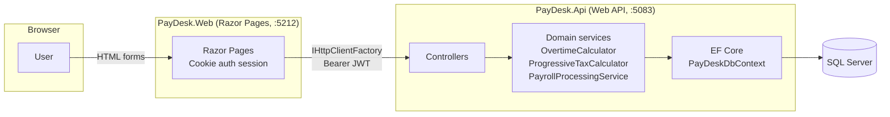

# PayDesk

[](https://github.com/edu-tech220/paydesk/actions/workflows/ci.yml)


A small payroll platform: employees log hours, managers approve them, and
admins run payroll for a pay period — overtime and income tax computed
automatically from configurable rules.

Built as two ASP.NET Core 8 microservices (a Web API and a Razor Pages
frontend) backed by SQL Server, with an EF Core-based optimistic concurrency
scheme that works identically against SQLite in the test suite.

## What it solves

Payroll looks simple from the outside — "multiply hours by rate" — until you
have to answer: *what happens when someone works 10 hours on a Tuesday and
42 hours in the week? What stops a manager from approving the same timesheet
twice at the same moment two tabs are open? What happens if "run payroll" is
clicked twice because the first request timed out?* PayDesk's API encodes
those answers as enforced business rules instead of client-side assumptions.

## Business rules

- **Daily + weekly overtime.** Hours past 8 in a single day are overtime at
  1.5x. On top of that, once the hours still classified as "regular" for an
  ISO week (Monday-Sunday) pass 40, the extra is converted to overtime too —
  without double-counting hours the daily rule already flagged.
  See `OvertimeCalculator`.
- **Progressive income tax.** Gross pay is taxed bracket by bracket (only the
  slice of pay inside each bracket is taxed at that bracket's rate), not a
  single flat rate on the whole amount. See `ProgressiveTaxCalculator`.
- **Pay period state machine.** `Open → Closed → Processed → Paid`. A period
  can't be closed while timesheet entries are still waiting on a manager's
  decision, can't be processed before it's closed, and can't be marked paid
  before it's processed.
- **Idempotent payroll runs.** Processing the same pay period twice returns
  the existing `PayrollRun` instead of recomputing or duplicating payslips —
  checked both up front and via a unique index as a race-safe fallback.
- **Optimistic concurrency on approvals and state transitions.** Every
  approve/reject/close/mark-paid call carries the `Version` the client last
  read. A stale version is rejected with `409 Conflict` instead of silently
  overwriting a concurrent decision; `PayDeskDbContext` also increments the
  token on every save so two truly simultaneous writes can't both succeed.
- **One entry per employee per day**, inside the pay period's date range,
  only while that period is still `Open`.
- **Role-scoped visibility.** Employees see only their own timesheets and
  payslips; managers see their direct reports'; admins see everything.

## Architecture



The frontend never talks to the database directly: every page action goes
through `PayDeskApiClient`, a typed `IHttpClientFactory` client that calls
the API over HTTP and forwards the JWT stored in the frontend's auth cookie.
This is the same boundary a truly separate frontend deployment would have.

## Technical decisions

| Decision | Why |
|---|---|
| Manual `int Version` concurrency token instead of SQL Server `rowversion` | `rowversion`/`timestamp` is a SQL-Server-only type. Tests run against SQLite, so the token is a plain column EF Core increments itself (`PayDeskDbContext.SaveChanges`), giving identical behavior on both providers. |
| PBKDF2 via `Rfc2898DeriveBytes`, not ASP.NET Core Identity | Keeps the hash/salt split explicit and the two columns easy to reason about, without pulling in Identity's user/role tables for a domain that already has its own `Employee` entity. |
| `WebApplicationFactory<Program>` + in-memory SQLite, not a real SQL Server in CI | `dotnet test` needs zero external services. `Program.cs` skips its SQL-Server-targeted `Database.Migrate()` call under the `Testing` environment; the test factory creates the schema from the current model instead (`EnsureCreated`) and reuses the same `SeedData` as production. |
| Domain exceptions + one exception-handling middleware | Controllers throw `EntityNotFoundException` / `BusinessRuleException` / `ConcurrencyConflictException`; `ApiExceptionMiddleware` is the only place that maps them to RFC 7807 `ProblemDetails`, so controllers stay free of repetitive try/catch blocks. |
| Separate DTOs in `PayDesk.Web`, no project reference to `PayDesk.Api` | The frontend is a separate deployable talking HTTP, like it would be if the two services lived in different repositories. |

## Endpoints

All routes except `/api/auth/login` require `Authorization: Bearer <token>`.

| Method | Route | Roles | Notes |
|---|---|---|---|
| POST | `/api/auth/login` | - | Rate-limited (10 req/min/IP). Returns a JWT. |
| GET | `/api/employees` | Admin, Manager | Paged. |
| GET | `/api/employees/{id}` | Admin, Manager, self | |
| POST | `/api/employees` | Admin | Hires a new employee. |
| PUT | `/api/employees/{id}` | Admin | |
| GET | `/api/timesheet-entries` | any | Scoped to self/direct reports/all by role. Paged. |
| POST | `/api/timesheet-entries` | any | One entry per employee per day, inside an `Open` period. |
| POST | `/api/timesheet-entries/{id}/approve` | Admin, Manager | Body: `{ expectedVersion }`. |
| POST | `/api/timesheet-entries/{id}/reject` | Admin, Manager | Body: `{ expectedVersion, reason }`. |
| GET | `/api/pay-periods` | any | Paged. |
| GET | `/api/pay-periods/{id}` | any | |
| POST | `/api/pay-periods` | Admin | Rejects overlapping date ranges. |
| POST | `/api/pay-periods/{id}/close` | Admin | Body: `{ expectedVersion }`. Blocked by pending approvals. |
| POST | `/api/pay-periods/{id}/process` | Admin | Idempotent; runs `PayrollProcessingService`. |
| POST | `/api/pay-periods/{id}/mark-paid` | Admin | Body: `{ expectedVersion }`. |
| GET | `/api/payslips` | any | Scoped to self/direct reports/all by role. Paged. |
| GET | `/api/payslips/{id}` | any | |

## Project structure

```
src/PayDesk.Api/      ASP.NET Core Web API: domain entities, EF Core, JWT auth, controllers
src/PayDesk.Web/      ASP.NET Core Razor Pages frontend, calls the API via IHttpClientFactory
tests/PayDesk.Api.Tests/   xUnit: unit tests for the calculators + integration tests (WebApplicationFactory + SQLite)
```

## Running it

### Option A: Docker Compose (API + Web + SQL Server)

```bash
docker compose up --build
```

- Frontend: http://localhost:8081
- API + Swagger: http://localhost:8080/swagger

### Option B: `dotnet run` (needs a local or containerized SQL Server)

```bash
# Start just SQL Server if you don't have one:
docker run -e "ACCEPT_EULA=Y" -e "MSSQL_SA_PASSWORD=Your_strong_password123" -p 1433:1433 -d mcr.microsoft.com/mssql/server:2022-latest

dotnet run --project src/PayDesk.Api     # http://localhost:5083 (Swagger at /swagger)
dotnet run --project src/PayDesk.Web     # http://localhost:5212
```

`PayDesk.Web`'s `Api:BaseUrl` already points at the API's `launchSettings.json`
HTTP port (5083), so both `dotnet run` commands work together with no extra
configuration.

### Demo accounts (seeded automatically on first run)

| Role | Email | Password |
|---|---|---|
| Admin | `admin@paydesk.local` | `Admin123!` |
| Manager | `manager@paydesk.local` | `Manager123!` |
| Employee | `employee@paydesk.local` | `Employee123!` |

## Testing

```bash
dotnet test
```

36 tests, no external services required: unit tests for the overtime and
tax calculators, plus integration tests that boot the real API pipeline
(JWT auth, controllers, middleware) against an in-memory SQLite database via
`WebApplicationFactory`. Coverage includes the full timesheet
submit → approve/reject flow, the pay period state machine, a golden-path
payroll run with hand-checked overtime/tax/net numbers, idempotent
re-processing, and role-based authorization.
